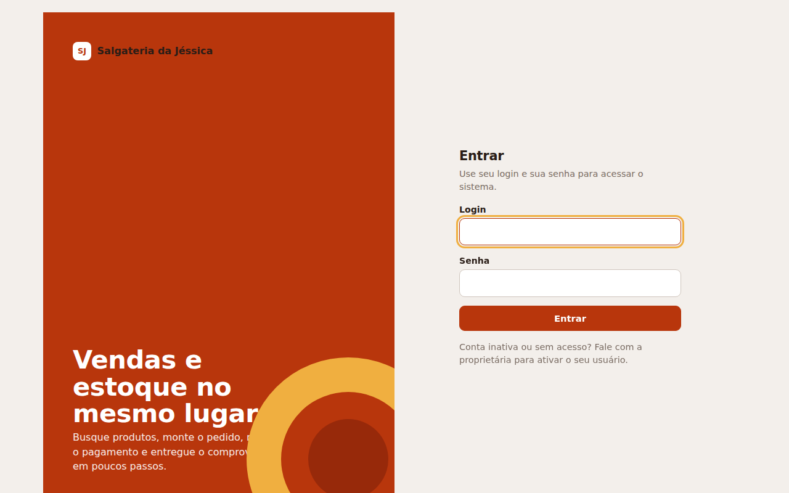
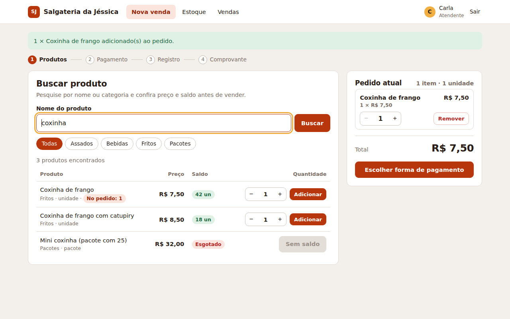
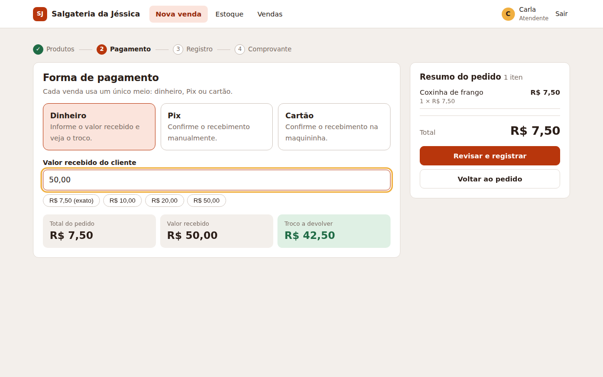
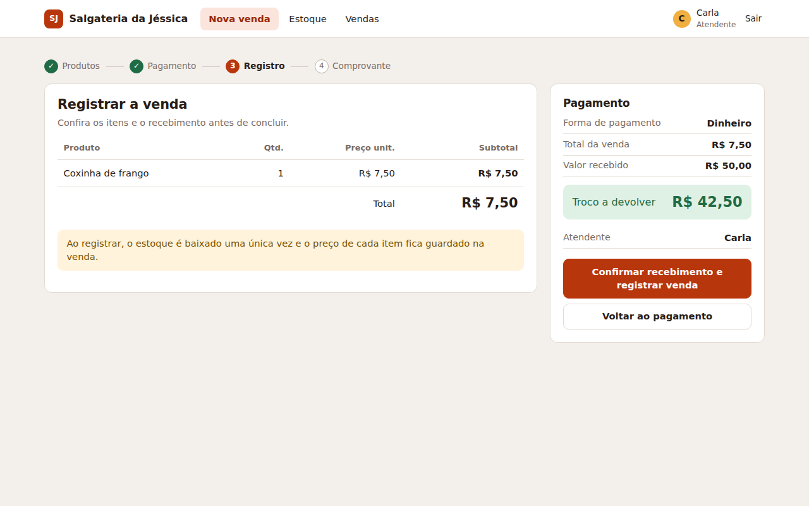
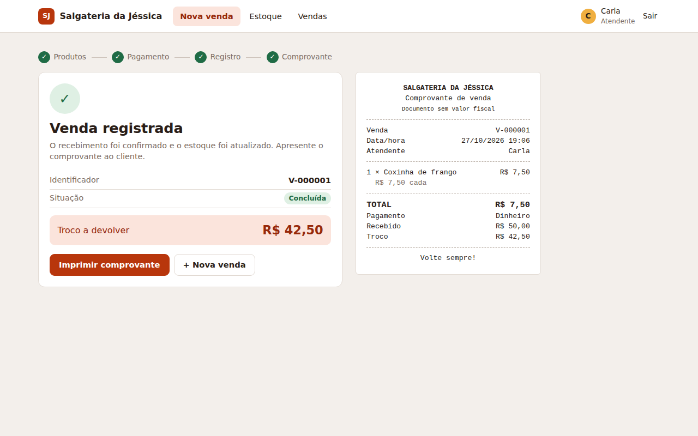

# Relatório — Salgateria da Jéssica (AEX · Programação para Internet)

**Equipe:** Gabriel Ramos, Marcelo Sousa, Rafael Cunha · **Tecnologia:** Python + Django + SQLite

## 1. O que foi implementado
Sistema web completo para o fluxo de venda do diagrama de atividades: login por perfil, busca de produtos com preço e saldo, pedido com validação de saldo, pagamento em dinheiro (com troco), Pix e cartão (confirmação manual), conclusão com baixa de estoque e comprovante imprimível. Também: catálogo (cadastrar, editar, inativar, excluir), consulta de estoque, reposição, ajuste de inventário com histórico de movimentos, lista de vendas e relatório por período e forma de pagamento. As 10 histórias de usuário e os 16 requisitos funcionais foram cobertos.

## 2. O que ficou de fora
Itens que a própria especificação deixou fora do escopo (RN08): cliente, venda on-line, entrega, desconto, pagamento dividido, devolução parcial, cancelamento de venda e emissão fiscal. Backup automático (RNF08) ficou como procedimento manual descrito no README. A tela de gestão de usuários usa o Django Admin.

## 3. O que mudou em relação à modelagem
- O diagrama de classes tem `Usuario.senha`; no Django a senha é guardada com hash (nunca em texto puro) e `login`, `nome` e `ativo` mapeiam para campos do `AbstractUser`.
- `MovimentoEstoque.quantidade` guarda a **variação** com sinal (entrada +, venda −, ajuste ±), o que simplifica o histórico.
- `Produto` ganhou o campo `unidade` (RF03 cita "unidade vendável"), e a regra de saldo ficou nos serviços do módulo de estoque, não em `Produto.baixarEstoque`.
- A mockup do comprovante dizia "Jéssica Salgados"; usamos "Salgateria da Jéssica", nome do estabelecimento.
- Excluir produto só vale para produtos sem histórico; os demais são inativados (RN07).
- Pix/cartão: acrescentamos uma caixa de confirmação explícita no passo de registro (HU07).

## 4. Dificuldades encontradas
*(Preencham com a experiência real da equipe. Pontos que apareceram no desenvolvimento: garantir a baixa única de estoque dentro de uma transação; trabalhar com dinheiro em centavos e converter "7,50" ↔ 750; manter o pedido salvo entre as telas sem depender de sessão.)*

## 5. Telas
| | |
|---|---|
| Login |  |
| Busca e pedido |  |
| Pagamento |  |
| Registro |  |
| Comprovante |  |
